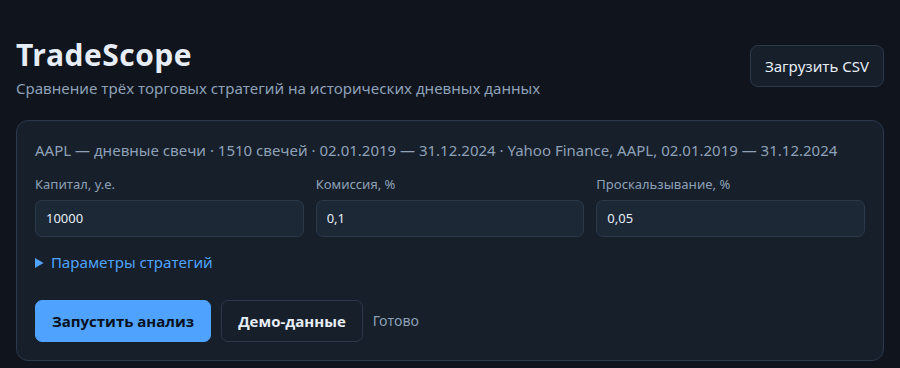
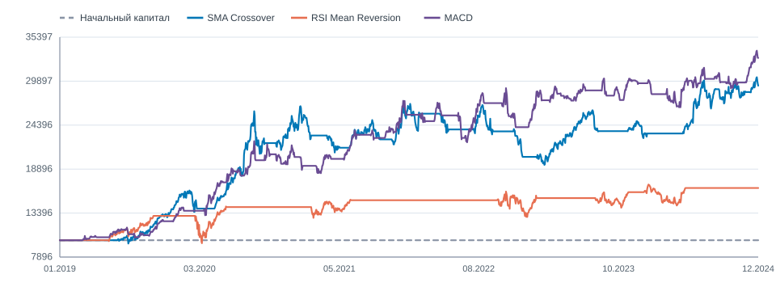

## Слайд 1

**КУРСОВОЙ ПРОЕКТ**

**Тема:** Исследование алгоритмических торговых стратегий на основе анализа временных рядов и их визуализация

**МИНИСТЕРСТВО НАУКИ И ВЫСШЕГО ОБРАЗОВАНИЯ РОССИЙСКОЙ ФЕДЕРАЦИИ**
Федеральное государственное автономное образовательное учреждение высшего образования
«Национальный исследовательский ядерный университет «МИФИ» (НИЯУ МИФИ)
Институт интеллектуальных кибернетических систем (ИИКС)
Кафедра компьютерных систем и технологий (№12)

**Направление подготовки:** 09.05.01 — Применение и эксплуатация автоматизированных систем специального назначения. Автоматизированные системы обработки информации и управления специального назначения

**Дисциплина:** Логические основы систем специального назначения с элементами системного анализа
**Семестр:** 5

**Выполнил студент:** Чесноков А.Н., гр. С24-501
**Руководитель:** Кулик С.Д., профессор кафедры №12 НИЯУ МИФИ

**Москва, 2026**

---

## Слайд 2

**Проблема и актуальность**

* Сравнение торговых стратегий вручную занимает много времени и легко приводит к ошибкам.
* Разные формулы и правила исполнения делают результаты несопоставимыми.
* Часто не учитываются комиссия, проскальзывание и заглядывание в будущее.
* Нужен воспроизводимый инструмент: данные → сигналы → сделки → метрики → графики.

---

## Слайд 3

**Цель и задачи**

**Цель:** автоматизировать бэктестинг и сравнение трёх стратегий, снизив время анализа.

**Задачи:**
1. Рассмотреть стратегии и метрики.
2. Реализовать загрузку и проверку CSV.
3. Реализовать SMA, RSI, MACD и единый движок.
4. Разработать веб-интерфейс с графиками.
5. Провести эксперимент и покрыть расчёты тестами.

---

## Слайд 4

**Стратегии и показатели**

| Стратегия | Тип | Сигнал покупки | Параметры |
| :--- | :--- | :--- | :--- |
| SMA Crossover | Следование за трендом | Короткая SMA пересекает длинную снизу вверх | 20 / 50 |
| RSI Mean Reversion | Возврат к среднему | RSI пересекает уровень 30 снизу вверх | 14, уровни 30 / 70 |
| MACD | Следование за трендом | MACD пересекает сигнальную снизу вверх | 12 / 26 / 9 |

**Метрики:** итоговая доходность, максимальная просадка, число сделок, Win Rate, средняя доходность сделки, коэффициент Шарпа.

---

## Слайд 5

**Методика бэктестинга**

* Одна длинная позиция, полное вложение капитала.
* Сигнал по закрытию свечи `t` исполняется по открытию свечи `t + 1`.
* Комиссия — 0,1 %, проскальзывание — 0,05 % на каждой сделке.
* Капитал пересчитывается на закрытии каждой свечи.
* Открытая позиция принудительно закрывается в конце периода.

Цена покупки: `Open × (1 + s)`, цена продажи: `Open × (1 − s)`.

---

## Слайд 6

**Архитектура**

* Go-монолит без внешних зависимостей.
* `cmd/server` — HTTP и статика; `cmd/experiment` — расчёты для отчёта.
* `internal/tradescope` — CSV, стратегии, бэктест, метрики.
* `web` — HTML, CSS, JS и пять графиков на Canvas.
* `POST /api/backtest`; пустой `csv` → демонстрационный набор.

`Клиент → HTTP → cmd/server → internal/tradescope → JSON → Canvas`

---

## Слайд 7

**Данные**

* AAPL, дневные свечи, 02.01.2019 — 31.12.2024, 1510 дней (Yahoo Finance).
* Цены с поправкой на дробление; дивиденды не учитываются.
* Проверка CSV: столбцы, даты, цены, OHLC, дубликаты, `NaN` и бесконечности.
* Диапазон цен: 35,55–259,02 долл.; годовая волатильность — 30,85 %.

---

## Слайд 8

**Веб-интерфейс**

* Загрузка CSV или демонстрационный набор.
* Параметры капитала, издержек и стратегий.
* Карточки, таблица сравнения и автоматические выводы.
* Пять графиков на Canvas без внешних библиотек и CDN.

---

## Слайд 9

**Результаты эксперимента**

Начальный капитал — 10 000 у.е., комиссия — 0,10 %, проскальзывание — 0,05 %.

| Стратегия | Доходность | Просадка | Сделок | Win Rate | Sharpe | Капитал |
| :--- | ---: | ---: | ---: | ---: | ---: | ---: |
| SMA Crossover | +193,34 % | 28,21 % | 16 | 56,25 % | 0,95 | 29 334 |
| RSI Mean Reversion | +65,33 % | 26,22 % | 6 | 100,00 % | 0,53 | 16 533 |
| MACD | +228,02 % | 18,91 % | 54 | 51,85 % | 1,17 | 32 802 |
| Покупай и держи | +534,30 % | 31,43 % | — | — | — | — |

---

## Слайд 10

**Анализ результатов**

* MACD: +228,02 %, просадка 18,91 %, Sharpe 1,17.
* SMA: +193,34 %, просадка 28,21 %.
* RSI: +65,33 %, всего 6 сделок; 100 % Win Rate ненадёжен.
* Buy & hold: +534,30 %, просадка 31,43 %.
* Разброс доходности — 162,69 п.п.

---

## Слайд 11

**Устойчивость на подпериодах**

| Период | Лидер по доходности | Доходность | Просадка |
| :--- | :--- | ---: | ---: |
| 2019–2022 | MACD | +141,42 % | 18,91 % |
| 2023–2024 | SMA Crossover | +24,07 % | 11,75 % |

* RSI оставался наименее доходным в обоих периодах.
* Во втором периоде просадка MACD (11,91 %) была близка к минимальной у SMA (11,75 %).
* Рейтинг стратегий зависит от периода; переносить его на будущее нельзя.

---

## Слайд 12

**Тестирование и воспроизводимость**

* `go test ./...`, `go vet ./...`, `go build ./...`.
* Тесты: CSV, индикаторы, исполнение `t + 1`, издержки, метрики.
* `go run ./cmd/experiment` → `results.json` и `results.typ`.
* Числа в отчёте — из `results.typ`; PDF — 27 страниц.

---

## Слайд 13

**Ограничения**

* Один инструмент и один период с сильным ростом.
* Параметры не оптимизировались и не проверялись на других данных.
* Постоянные издержки; дивиденды не учитываются.
* Мало сделок RSI; результаты — не прогноз.

---

## Слайд 14

**Заключение**

* Цель достигнута: работает приложение TradeScope.
* Реализованы три стратегии, единый бэктест, метрики, API, интерфейс и тесты.
* На данных AAPL 2019–2024 лучшей из стратегий стала MACD; buy & hold доходнее, но риск выше.
* Развитие: больше инструментов, walk-forward, моделирование проскальзывания, дивиденды, короткие позиции, экспорт отчётов.

---

## Слайд 15

**Спасибо за внимание!**
